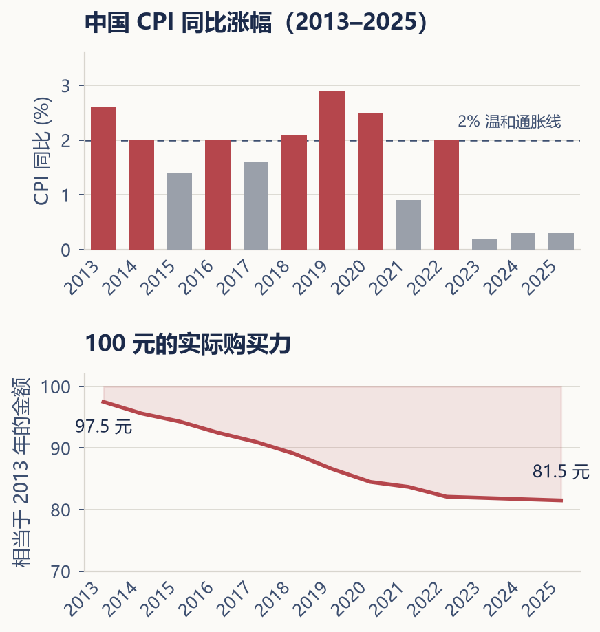

---

## 第六章 · 通货膨胀如何侵蚀购买力

> **现金看似安全，但在时间面前，安全本身就是风险。**

---

很多人觉得，把钱放在银行账户里是最保守、最安全的做法。从某个角度说，这没错——你不会在某一天打开账户发现数字变少了。但如果把时间拉长到十年、二十年，你就会发现，虽然账户上的数字没有变少，但这些数字能买到的东西，却在慢慢变少。

这就是**通货膨胀（inflation）**——物价普遍持续上涨，导致货币的购买力下降。

### 一百元的三十年

先看一个有明确时期的观察：国家统计局公布的全年居民消费价格涨幅，2023 年为 0.2%，2024 年为 0.2%，2025 年与上年持平。物价并非每年按固定比例上涨，也不能用收入或消费支出的增长倍数直接代替通胀；后两者还受消费数量、品质与人口结构影响。

（来源：[2023 年 CPI 发布](https://www.stats.gov.cn/sj/zxfb/202401/t20240112_1946465.html)、[2024 年经济运行发布](https://www.stats.gov.cn/sj/zxfb/202501/t20250117_1958332.html)、[2025 年统计公报](https://www.stats.gov.cn/sj/zxfb/202602/t20260228_1962662.html)；查阅日期：2026-11-05。下文 3% 为独立教学假设，不是这三年数据的外推。）

更直观的方式是看通货膨胀如何影响购买力。假设每年的通货膨胀率是 3%。你有一笔 10 万元的存款，每年什么都不做，只是放在那里。第一年后，这笔钱的"名义金额"仍然是 10 万元，但它的"实际购买力"只相当于大约 97,000 元。十年后，实际购买力下降到约 74,000 元。二十年后，只剩约 54,000 元。三十年后，不到 40,000 元。

也就是说，你什么都没做，三十年后你的钱缩水了六成。这不是因为银行偷了你的钱，而是因为物价一直在悄悄上涨，而你手中的现金没有能力跟上这种上涨。

---

```{=latex}
\bookillustration{12-inflation-ghost.png}{105mm}{同样一张钞票，随着物价上涨，能买到的东西可能越来越少。}
```

### CPI 不等于你感受到的通胀

国家统计局每个月会发布 **CPI（Consumer Price Index，居民消费价格指数）**，这个数字代表的是"一篮子商品和服务"价格的平均变化。但每个人的消费结构不同，所以每个人感受到的通胀也不同。

如果你不抽烟、不喝酒，那么烟酒价格上涨对你没有影响。如果你需要租房而不是已经拥有自住房，那么房租上涨对你的冲击远大于对有房者。如果你有孩子在上学，教育支出的增长可能才是你最大的压力来源。如果你或家人有医疗需求，医疗费用的增幅往往远超 CPI 平均数。

因此，在评估通胀对个人财务的影响时，与其盯着新闻里的 CPI 数据，不如回顾一下自己家庭的真实支出变化。三年前你每个月的开销是多少？今天是多少？但总支出增加也可能来自换房、家庭成员变化或买得更多；若想估计个人面对的价格变化，要尽量比较相同数量和品质的一篮子消费。

---

### 现金的安全与购买力风险

每一种资产都有风险，只不过风险的形式不同。股票的风险是价格波动——今天可能涨，明天可能跌，账面价值忽上忽下。债券的风险是利率变化和信用违约。而现金的风险，就是通货膨胀导致的购买力下降。

很多人只看到了波动的风险，却忽视了通胀的风险——因为前者看得见，后者看不见。股票跌了 20%，你打开账户就能看到。但现金的购买力每年缩水 3%，你看不到任何红色的数字，只有等你去超市、去交房租、去付孩子的学费时，才会隐隐约约感觉到："钱好像越来越不经花了。"

这就是为什么，把所有积蓄都放在现金或活期存款里，看似安全，实则是在承担一种"安静的亏损"。实际购买力要同时看获得的利息与物价变化；现金也在支付和应急中提供必要的流动性。

### 如何计算实际收益率

当你看到一项投资的名义收益率时，不能直接用它来和通货膨胀率比较。你需要计算**实际收益率（real rate of return）**。

同一期限下，实际收益率 =（1 + 名义收益率）÷（1 + 通胀率）− 1。收益率较小时，可近似用名义收益率减去通胀率；还应计入适用税费。

如果一只基金去年的名义收益率是 5%，而同期的通货膨胀率是 3%，那么你的实际收益率大约是 2%。这 2% 才是你购买力真正的增长。如果名义收益率是 3%，通胀率也是 3%，那么你的实际收益率为零——你的购买力和一年前完全一样。如果名义收益率低于通胀率，那么你的购买力实际上在下降，尽管账户里的数字看起来在增加。

因此，在评估任何一项投资的时候，不能只看它"赚了多少"，还要看它"跑赢了通胀多少"。一个年化 3% 的银行理财产品，在通胀率为 2% 的时候看起来还不错；但如果通胀上升到 4%，它实际上在让你悄悄变穷。

---

通货膨胀不会在一天之内改变你的生活，但它会在几十年里重新定义你手中每一分钱的价值。那些今天看起来"足够"的积蓄，如果没有任何增值，十年后可能只能覆盖一半的生活。这就是为什么我们需要投资——不是为了追求刺激，而是为了让我们的财富至少跟上物价的步伐，最好还能跑赢它，让未来拥有更多实实在在的购买力。



接下来的问题是：既然我们愿意承受一定的风险去追求更高的回报，那么风险到底是什么？它比大多数人想象的更复杂。
