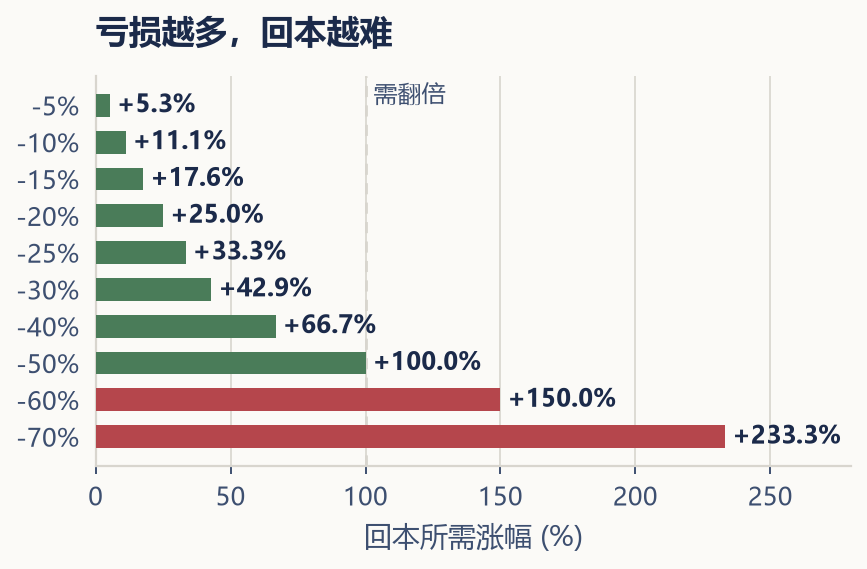

---

## 第七章 · 风险不只是价格下跌

> **真正的风险，不是资产的价格在变化，而是在你不了解的时候做出了决定。**

---

"这只股票风险太大了。""这个理财应该没有风险。""我不想承担任何风险。"——在日常对话中，人们习惯把风险简单地等同于"可能会亏钱"。但在投资的世界里，风险是一个远比"亏钱"复杂得多的概念。如果不能对风险建立一个更完整的认识，就很难做出理性的投资决策。

### 波动不是风险的全部

假设基金价格下跌了 10%。对于明天就要交首付的人，这次波动可能破坏购房计划；对于没有近期提款需求的人，影响又不同。价格会不会恢复、何时恢复，当下都不能保证。

**波动（volatility）** 描述价格或收益的起伏；**永久性资本损失（permanent loss of capital）** 则提醒我们注意价值无法恢复的可能，例如企业破产或发行人违约。二者需要区分，但不能由此认为账面下跌没有风险，或只有卖出才发生经济损失。

更实用的问题是：这笔钱何时要用，是否有杠杆，收入中断后能撑多久，资产的持有理由是否仍成立？市场变化会通过现金流、提款与行为影响生活。长期期限可以增加调整余地，不能保证任何资产回本。

历史回撤只能描述已发生的样本，不是未来损失上限。比较恢复时间时，必须统一从前高还是谷底起算，以及价格指数还是含分红总回报。本章不使用缺少统一口径和原始记录的历史恢复表，后面的教学算例只讨论数学关系。

### 风险的不同面貌

除了市场价格波动，投资者实际上还面临着许多不同层面的风险。它们并不总是同时出现，但每一种都可能对你的投资组合产生影响。

**信用风险（credit risk）**，指的是债券或其他债务工具的发行人无法按时支付利息或偿还本金的风险。不同政府与企业的信用质量不同，债务币种和偿付能力也要分别判断。评级机构（如标普、穆迪、惠誉）会为债券提供信用评级，但评级并非保证——历史上也出现过评级下调甚至违约的事件。

**利率风险（interest rate risk）**，主要影响债券和债券基金。当市场利率上升时，已发行的债券价格会下跌。原因很简单：新发行的债券利率更高，旧债券的相对吸引力下降，价格自然回落。我们将在第十章详细讨论这个机制。

**流动性风险（liquidity risk）**，指的是无法在需要的时候以合理价格快速卖出资产。比如一套房产，可能挂了半年还卖不掉；一只冷门的小盘股，可能因为成交清淡而出现大幅折扣才能脱手。流动性风险在极端市场环境下尤其明显——当所有人都在抛售时，你会发现买家突然消失了。

**汇率风险（currency risk）**，是在投资海外资产时必须考虑的因素。如果你用人民币买入了一只美元计价的资产，即使资产本身的价格没有变化，人民币对美元汇率的波动也会影响你的实际收益。人民币相对美元升值时，未对冲的美元资产折成人民币可能缩水；反之可能受益。交易币种并不自动等于底层资产的全部汇率暴露。

**集中度风险（concentration risk）**，来自过度集中于某一种资产、某一个行业或某一个国家。持有十只科技股，并不等于"分散投资"——它们面对的风险因素高度相似。真正的分散，是在不同风险来源之间分配资金。

**杠杆风险（leverage risk）**，来自使用借来的钱进行投资。在忽略融资成本、费用与保证金约束的单期数学模型中，两倍资产敞口会把 10% 的价格变化放大为约 20% 的自有资本变化。实际还可能面临追加保证金、强制平仓与超过本金的损失。杠杆是双刃剑，对于新手投资者来说，最安全的建议是：在完全理解杠杆的成本与风险之前，不要使用它。

**期限错配风险（maturity mismatch risk）**，发生在投资期限与资金需求不匹配的时候。如果你用一笔明年就要使用的资金投资了二十年期限的长期债券，当市场利率上升、债券价格下跌时，你无法等到债券到期收回本金——不得不在亏损时卖出。

**托管与平台风险（custody and platform risk）**，指的是投资资金存放的平台或托管机构出现问题的情况。选择合规、受监管的金融机构和交易平台，是降低这类风险最基本也是最重要的一步。不在本书的具体推荐范围内，但读者应当自行确认所使用的平台是否持有合法牌照。

---

### 亏损之后，需要涨更多才能回本

很多人低估了亏损的恢复难度。下跌和上涨在数学上并不是对称的。

| 亏损幅度 | 需要上涨多少才能回本 |
|---------|-------------------|
| -10% | +11.1% |
| -20% | +25.0% |
| -30% | +42.9% |
| -40% | +66.7% |
| -50% | +100.0% |
| -60% | +150.0% |
| -70% | +233.3% |

（来源：纯数学模型，回本涨幅 = 1 ÷（1 − 亏损幅度）− 1；无追加投入与提款，未计税费；复核日期：2026-11-05。）

这张表最值得关注的是：亏损超过 50% 以后，回本所需的涨幅变得极其陡峭。亏损 70%，需要涨两倍多才能回本。这就是为什么控制大幅回撤比追求短期高收益更为重要。一次致命的亏损，可能耗尽你很多年积累的所有收益。

---

风险管理不是要消灭风险，而是要理解你承担的是什么风险、为什么承担它，以及这个风险是否在你的可承受范围之内。承担风险并不自动获得更高回报；有些集中风险可以通过分散减少，也未必获得额外补偿。先理解它怎样影响目标，再决定是否承担。

接下来的问题是：你怎么知道，自己到底能承受多大的风险？

概念参考：[SEC 资产配置、分散与再平衡入门](https://www.sec.gov/investor/pubs/assetallocation.htm)；查阅日期：2026-11-05。
