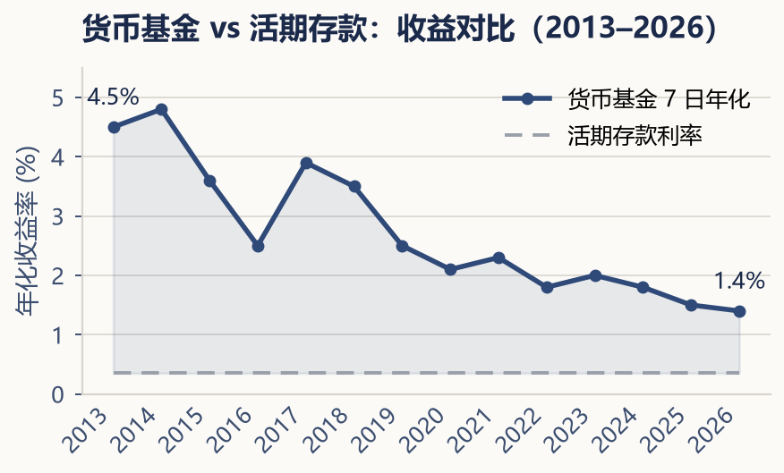

---

**第三部分 · 钱到底可以放在哪里**

## 第九章 · 现金、存款与货币类工具

> **现金不是无用的，它只是在等待它的任务。**

---

在追求投资收益的路上，现金常常被当作反面教材——收益低、跑不赢通胀、放在账户里就是在贬值。这些批评并非全无道理：长期持有大量现金确实不是明智之举。但如果我们因此得出"现金无用"的结论，就走到了另一个极端。

现金在投资组合中承担着不可替代的角色：提供流动性、保障应急资金、平衡整体风险。就像一支球队不能只有前锋没有守门员，一个健康的财务体系也不能只有高波动资产而没有现金缓冲。

### 现金的四种形态

**活期存款（demand deposit）** 是最基础的形式。通常可用于日常支付，但仍有额度、渠道及合规等限制，利率也最低。它的用途是覆盖日常开支——这个月的房租、水电、吃饭、交通。你不需要从活期存款中获得收益，你只需要知道自己随时可以用。

**定期存款（time deposit / certificate of deposit）** 锁定期限，换取比活期更高的利率。三年期定期存款的利率通常高于一年期，一年期又高于活期。代价是如果提前取出，利息会按活期利率计算甚至损失全部利息。因此定期存款只适合存放确定在近期内不会动用的资金——比如三个月后要交的保费、半年后需要的装修款，而不是你的长期投资。

**货币基金（money market fund，简称货基）** 是近十年在中国普及速度最快的现金管理工具。余额宝、零钱通等产品的底层资产，本质上都是货币基金。货币基金主要投资于短期国债、银行定期存单、高等级短期债券等低风险工具，因此收益率通常高于活期存款而略低于较长期限的定期存款，但流动性远好于定期存款——具体赎回与到账安排取决于产品和渠道，快速服务可能有额度限制。

货币基金收益会随底层利率与持仓变化，不能把某个七日年化值理解为未来一年保证收益。它也不同于存款：需要检查本金风险、快速赎回额度、到账时间及产品合同。这里不使用缺少指定观测日的多年收益曲线。

比较利息累积可以先做纯数学练习：本金 10,000 元、固定年收益率分别为 1%、2%、3%，五年不追加、不提款、不计税费，终值分别约为 10,510、11,041、11,593 元。这些仅是模型参数，不代表货币基金或银行报价。

（风险概念参考：[Investor.gov 货币基金说明](https://www.investor.gov/introduction-investing/investing-basics/investment-products/mutual-funds-and-exchange-traded-5)；查阅日期：2026-11-05。产品保障与交易条件依所在地及合同核对。）

**短期国债类工具（short-term government bond instruments）**，比如国债逆回购或短期国债ETF，兼具安全性和一定收益，但它们通常需要证券账户才能操作。对于初学者来说，货基和银行存款已经足够覆盖现金管理的需求，不必一开始就为了多几个点的收益而把简单的事情变复杂。

### 现金在组合中的职责

很多人会犯一个错误：把资产配置等同于"如何分配投资资金"，而忽略了现金本身就是一种配置。

现金的职责不是赚钱，而是给你三个东西：安全感、选择权、操作空间。当你确定自己有三个月到六个月的生活费用随时可以动用时，你在面对市场下跌时的心态会完全不同——因为你不需要被迫卖出资产。当市场出现难得的低估机会时，拥有现金的人可以选择买入，而全部资金被锁在资产里的人只能旁观。

但现金也不宜过多。超过应急资金和中短期目标所需的现金，长期闲置在低收益账户里，实际上是在承担通胀风险。一个简单的原则是：应急资金和中短期目标所需资金放在现金或类现金工具中；其余的资金，根据自己的投资期限和风险承受能力，配置到能够产生长期回报的资产中。

---

现金很无趣，它不会给你讲令人兴奋的增长故事。但它是你所有投资中最忠实的那一部分——它的价值在于按时支付和减少被迫变现的压力；具体产品仍须核对本金风险与可用性。

在下一章，我们将讨论现金之外的第一个"可投资资产"：债券。
