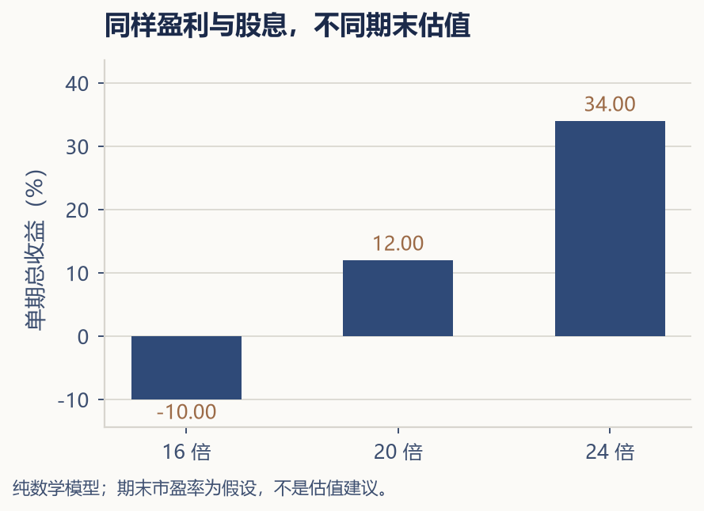

---

## 第十一章 · 股票收益从哪里来

> **买股票不是买一串代码，而是买一家企业未来创造价值的能力。**

---

对于很多第一次接触股票的人来说，股票市场给人的印象就是红红绿绿的数字、上下跳动的曲线，以及社交媒体上那些令人羡慕或令人恐惧的收益截图。这种印象不能说完全错误——股价确实每天都在波动。但它掩盖了一个更基本的事实：股票代表的是一家企业的部分所有权。长期来看，股票的价格最终会反映这家企业所创造的价值。短期来看，股价更多反映的是市场参与者的情绪。

理解股票收益的来源，是区分投资和投机的第一道分水岭。

### 股票收益，来自三个地方

如果你持有一只股票，你的总回报（total return）来自三个部分。

第一部分是**股息（dividend）**。企业赚了钱之后，可以选择把一部分利润以现金的形式分配给股东。股息直接以现金进入你的账户，是最实在的回报形式。成熟型的大企业——比如银行、公用事业公司、消费品公司——往往有相对稳定的分红政策。成长型企业则通常将利润再投资于业务扩张，因此分红较少甚至完全不分红。

第二部分是**盈利增长（earnings growth）**。企业的利润在增长，它作为一家公司的内在价值也在增长。如果市场给予的估值（市盈率等指标下详）保持不变，那么股价的涨幅就应该大致等于盈利的涨幅。这是股票长期收益的最根本来源——企业创造的真实价值。

第三部分是**估值变化（valuation change）**。市场给同一家企业"出价"的高低，会受到利率、情绪、政策、宏观经济等多种因素的影响。有时一家企业盈利能力并未发生显著变化，但由于市场整体变得乐观或悲观，它的股价仍然可能大幅波动。估值变化是短期股价波动的主要驱动因素，但它在长期中的影响通常小于盈利增长。

先做一个可复算的单期例子：买入价 100 元，每股盈利 5 元，市盈率 20 倍。下一期每股盈利变为 5.5 元，并支付每股股息 2 元。如果期末市盈率分别为 16、20、24 倍，股价分别为 88、110、132 元，对应含现金股息的持有期总收益为 −10%、12%、34%。

（来源：纯数学模型，股价 = 每股盈利 × 市盈率；总收益 =（期末股价 + 现金股息）÷ 买入价 − 1；一期、无税费、不将股息再投资；复核日期：2026-11-05。输入是教学假设，不代表任何市场历史拆解。）

盈利增长并不保证买入后赚钱，估值变化也可能持续影响长期回报。股息、盈利与估值需要一起看；公司增发、回购及指数成分变化，也会影响每股和聚合统计口径。

### 好公司不一定是好投资

这是一个初学者经常感到困惑的地方。一家企业产品质量优秀、品牌知名度高、管理层能力强——它是一家"好公司"。但你买入它的股票，是否就一定是一笔"好投资"？

如果价格已经包含未来高速增长的预期，后来公司虽仍增长，却低于原来的预期，股价就可能下跌。判断好公司是否也是好投资，需要看买入价格要求它未来做到什么。

反过来，一家看起来平平无奇的企业，如果经营稳定、现金流充裕、估值被市场长期低估，也可能在多年后为耐心的投资者带来可观的回报。

因此，投资股票不只是研究企业本身，还要研究你付出的价格。价格是你付出的，价值是你得到的。两者之间差距越大，你的安全边际（margin of safety）就越宽。

### 市值与股价：不要被表面数字迷惑

很多人习惯用"一股多少钱"来判断股票贵不贵。茅台一股一两千元，某家小公司一股才几块钱——是不是小公司更便宜？这个类比是错误的。

一只股票贵不贵，不看它的每股价格，而看它的总市值相对于它创造利润的能力。一家总市值 10 亿元、每年赚 2 亿元的企业，其股价可能比一家总市值 100 亿元、每年只赚 1 亿元的企业更"便宜"。你需要看的是估值指标——比如市盈率（P/E ratio），而不是股价本身。

### 长期收益不等于短期价格的放大

讨论长期历史回报时，应指定市场、币种、起止日期、分红与通胀口径。本章用数学例子说明机制，不采用无法回查原始序列的百年精确回报概括。长期持有仍可能亏损，也不能只靠改变观察尺度就消除风险。

问题是，在这"长期"的每一年之中，市场的表现可能完全不同。某一年涨 30%，某一年跌 40%，某一年波澜不惊。如果你计划用五年内需要的钱去买股票，你就可能在市场刚好低迷的那一年被迫以一个糟糕的价格卖出——这就是为什么我们在第四章强调了"投资期限"的重要性。

---

股票是投资组合中承担"增长引擎"角色的资产。是否需要股票，要结合支出目标、其他资产与风险能力决定。但持有股票需要两样东西——对企业价值的基本理解，以及对波动保持理性的能力。幸运的是，不是所有人都需要自己挑选个股。在本书的后半部分，我们将用大量篇幅讨论一种更简单但也同样有效的方式：通过指数基金和 ETF 来拥有整个市场，而不是赌某一家企业的命运。

在此之前，我们先把目光转向另外两类资产——黄金和 REITs——它们在不同的人生组合中扮演着各自独特的角色。
