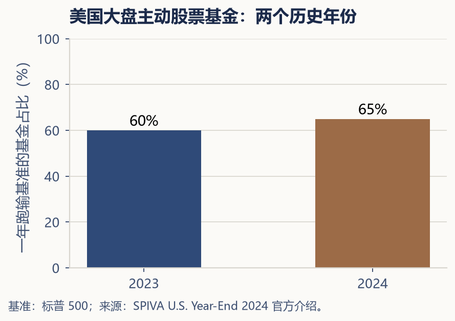

---

## 第十八章 · 主动基金应该怎么看

> **买主动基金，不是买一只基金——是选择一个人、一个团队、一种投资哲学。**

---

在前面几个章节中，我们花了大量篇幅讨论指数 ETF。但在很多人的投资组合中，主动管理基金仍然占有重要的一席之地。主动基金与被动基金之间并不是"一个绝对好、一个绝对坏"。它们只是在用不同的方式解决同一个问题：如何让投资者的资金增值。

### 主动与被动：根本的分歧

主动基金的基金经理试图通过自己的研究和判断，选出能够战胜市场的股票或债券——在好的价格买入，在更好的价格卖出，实现超越市场平均水平的回报。被动基金（如指数 ETF）的目标则简单得多：尽可能准确地复制某个市场指数的表现，不主动做任何判断，只求不输给市场。

主动基金要跑赢被动基金，必须克服两个障碍：一是费用——主动基金的管理费通常远高于被动基金；二是市场效率——在一个由成千上万专业投资者参与的市场中，持续击败对手是一件极其困难的事情。

SPIVA（S&P Indices Versus Active）按报告地区、基金分类和基准统计主动基金表现。以 **SPIVA U.S. Year-End 2024** 为一个有明确日期的历史例子：2024 年美国大盘主动股票基金中，65% 跑输标普 500；同一官方介绍列出的 2023 年比例为 60%。这不是对全球全部主动基金的结论。

| 美国大盘主动股票基金 | 一年跑输标普 500 的比例 |
|---|---:|
| 2023 年 | 60% |
| 2024 年 | 65% |

（来源：[S&P 官方 SPIVA U.S. Year-End 2024 介绍](https://www.spglobal.com/spdji/en/spiva/article/spiva-us-year-end-2024/)；查阅日期：2026-11-05。这里保留历史报告名，不称其为最新报告。配图采用同一组两年数据。）

历史样本比例不能直接变成某只基金未来跑赢的概率。研究其他地区、类别或持有期，应找到对应报告与表格，同时检查费用、基准及消失基金的处理方式。持有期限不同也不等于同一只基金必然逐年变差。

### 评估一只主动基金的五个维度

如果你决定配置主动基金，以下几个评估维度比"近一年收益排名"重要得多。

**基金经理。** 一只主动基金的灵魂是管理它的那个人（或团队）。现任基金经理管理这只基金多久了？他之前的投资记录如何？他的投资理念是否清晰、前后一致？如果一只基金频繁更换基金经理，需区分不同管理期、团队与流程变化，不能把前任成绩直接当成现任能力。

**相对基准收益差。** 先比较基金与合适基准的同口径回报。一只年化回报 10% 的基金听起来不错，但如果它对应的基准指数同期年化回报是 12%，简单收益差为 −2 个百分点——实际上跑输了市场。反过来，一只年化回报 8% 的基金，如果基准是 5%，即使绝对回报不高，也说明相对基准收益差为正；风险调整后的 Alpha 还需要另行指定模型。

**风格漂移（style drift）。** 一只基金宣称自己是"大盘价值型基金"，但某段时间突然重仓了成长股或小盘股——这就是风格漂移。风格漂移意味着你买的和你以为自己在买的东西不一样。对于投资者来说，风格漂移会让资产配置变得不可控，因为你文件夹里本来打算作为"稳健配置"的基金，可能在不知不觉中变成了"激进配置"。

**最大回撤（maximum drawdown）。** 这只基金在历史上最大的"从高峰到低谷"的跌幅是多少？回撤幅度是否在你的风险承受范围内？一个年化回报很高的基金，如果历史上最大回撤达到了 50%，它可能不适合大多数非专业投资者——因为在那个回撤的过程中，绝大多数人会在最低点附近恐慌卖出。

**换手率（turnover ratio）。** 基金在一定时期内买卖股票的频率。换手率过高意味着频繁交易，产生更高的交易成本（包括佣金、印花税和买卖价差），这些成本最终由基金持有人承担。高换手也可能来自策略设计，不能仅凭这一项判断能力或动机；应看成本、策略一致性与实际结果。

### 幸存者偏差：你不能只看"活着"的基金

翻阅基金平台的排行榜，你会看到很多过去三五年表现优秀的基金。但那些过去表现糟糕、甚至已经被清盘或合并的基金，通常不会出现在排行榜上。这就是**幸存者偏差（survivorship bias）**——你只看到了"活下来的赢家"，而看不到已经消失的输家。

因此，排行榜本身无法告诉你选到一只优秀基金的概率有多高。如果你在五年前随机挑选了十只主动基金，到今天可能只剩七八只还在运营，而这七八只中真正跑赢基准的可能只有两三只。这个概率，才是你面对的真实选择环境。

### 如何阅读一份基金报告

每只公募基金都会定期发布季报和年报。你不必像专业人士一样逐字逐句地研读，但有几个地方值得花上十分钟。

首先是"基金经理报告"或"管理人报告"部分。基金经理通常会在这里阐述他对过去一个季度市场环境的判断、自己的操作逻辑以及未来展望。读完后你可以问自己：他的判断是否有逻辑？他的操作是否与他的理念一致？他是否诚实地承认了错误，还是把一切问题都归咎于"市场环境不好"？

其次是"资产组合"部分。看看十大重仓股票或债券是什么、各自占比多少、与上一期相比有什么变化。这能帮你判断基金经理是否出现了风格漂移。

最后是"费用"部分。确认你实际支付的管理费、托管费以及总的费率水平。如果一只主动基金的年化费率超过 1.5%，它需要产生远超市场水平的 Alpha 才能让费率物有所值——这在长期内对大多数基金来说都是一个艰难的目标。

---

主动基金可以为投资组合提供一些指数 ETF 无法替代的东西：在特定市场环境下的保护、对特定机遇的捕捉、以及某种特定的投资理念。但主动基金也是一件需要持续维护的工具——基金经理可能会离职、风格可能会漂移、超额收益可能会消失。和 ETF 的"买入并持有"不同，持有主动基金意味着你需要定期检查它是否仍然是当初你选择的那只基金。

在下一章，我们将讨论另外几种常见的基金类型——QDII、FOF 和养老目标基金——帮助你把视野从单一市场扩展到更广阔的领域。
