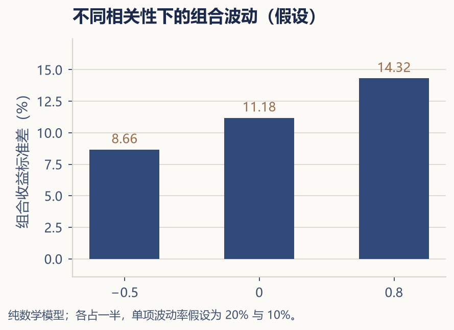

---

**第五部分 · 家庭资产配置**

## 第二十章 · 资产配置为什么比选股更重要

> **决定你长期收益的，不是哪只股票涨了，而是你把多少钱放在了哪些篮子里。**

---

**资产配置（asset allocation）** 是先决定资金承担哪些风险，再选择具体工具。有关研究中，组合自身随时间的收益变动、不同组合之间的表现差异与绝对收益水平，是不同问题；不能把前者的解释比例说成未来财富有同样比例由配置决定。

参考：[CFA Institute 对资产配置研究的辨析](https://rpc.cfainstitute.org/blogs/enterprising-investor/2012/setting-the-record-straight-on-asset-allocation?page=0)；查阅日期：2026-11-05。配置、费用、投入与提款都会影响最终目标是否实现。

### 相关性：资产配置的核心概念

资产配置之所以有效，不是因为某类资产"最赚钱"，而是因为不同资产之间并不总是同步波动。有些资产在股市大跌的时候反而上涨，有些资产在通胀加剧的时候提供保护，有些资产无论市场怎么变，每个月都安静地派发利息。

资产之间的联动关系，可以用**相关性（correlation）** 来衡量。相关性系数的范围从 +1（完全同步，你涨我也涨）到 -1（完全反向，你涨我跌），中间值表示两者之间没有明显的联动。

用一个纯数学模型理解相关性的作用：两项假想资产各占 50%，年收益波动率分别假设为 20% 和 10%。相关系数为 −0.5、0、0.8 时，组合波动率约为 8.66%、11.18%、14.32%。

（来源：两资产组合方差公式，波动率 = [w₁²σ₁² + w₂²σ₂² + 2w₁w₂σ₁σ₂ρ] 的平方根；权重各 0.5、波动率为设定常数，无历史市场输入；2026-11-05 复核。）

只改变相关性，组合的波动就不同。但波动率不是风险的全部，低线性相关也不代表没有尾部共振或目标缺口。实际估计要固定币种、日期、频率、分红口径和资产代理，保留原始收益序列，不能只提供一张手填矩阵。

相关性不是固定不变的——它在不同市场环境下会发生变化。例如在极端市场危机期间，几乎所有资产都可能同时下跌（相关性突然上升），这就是所谓的"风险资产联动"。理解这一点，可以帮助你避免在正常市场环境下过度自信，以为自己已经足够分散。真正的分散，应该在大多数情况下有效，并且你也要知道它在什么情况下可能失效。

### 分散投资的真正含义

持有十只科技股，算不算分散？从数量上看，你确实分散了——任何一家公司出现问题，你的损失有限。但从风险来源来看，这十家公司都面临相似的风险：科技行业周期、利率对成长股的估值压力、监管政策变化、技术路线颠覆。当科技板块整体受到冲击时，这十只股票很可能同时下跌。这是**虚假的分散**。

真正的分散，是在不同的风险来源之间分配资金。资产之间——股票 vs 债券 vs 黄金 vs 现金；地区之间——中国 vs 美国 vs 欧洲 vs 日本 vs 新兴市场；行业之间——科技 vs 消费 vs 金融 vs 能源 vs 医疗；币种之间——人民币 vs 美元 vs 其他主要货币。增加风险来源后仍需检查权重与共同驱动因素，不能仅凭资产名称不同认定已经降低风险。

但分散也有上限。当你持有的资产数量超过一定限度之后，继续增加资产种类带来的边际分散效果非常有限——这就是**过度分散（diworsification）**。持有五十只高度相似的基金，不会比持有两到三只覆盖面广的宽基 ETF 更安全，反而会让你的投资组合变得难以管理和理解。分散的目标不是让你成为"资产收藏家"，而是用最少的工具覆盖最广的风险面。

```{=latex}
\bookillustration{16-global-diversification.png}{105mm}{中国、美国、欧洲和日本是地理分散的示例。不同市场的资产也可能同时下跌。}
```

### 再平衡：让配置长期有效

资产配置不是"配一次管一辈子"。随着市场的涨跌，你最初配置好的比例会自然偏离。假设你最初设定的配置是 60% 股票和 40% 债券。一年之后，股票大涨了 30%，债券只涨了 5%。现在股票在组合中实际占到约 65%，债券 35%——你承担的风险已经高于最初的设计。

**再平衡（rebalancing）** 就是把比例拉回目标值——卖出部分股票、买入债券，或者用新增资金补齐不足的部分。再平衡的价值在于：它按规则恢复风险敞口，不自动识别估值高低，也不保证提高收益。这不是预测市场——你只是在恢复最初设定的风险敞口。关于再平衡的具体操作和时机，我们将在第二十五章详细讨论。

---

资产配置是整个投资体系中最核心、同时也最容易被忽视的环节。很多人花大量时间研究"买什么"，却从来没停下来想一想"我为什么要把这个比例放在这类资产上"。纠正这个顺序——先确定大类配置，再在每类配置中选择具体的工具——是让投资从"碰运气"走向"有体系"的关键转变。



在下一章，我们将讨论如何把钱分成几个账户——每个账户各司其职，让复杂的人生财务变得清晰有序。
