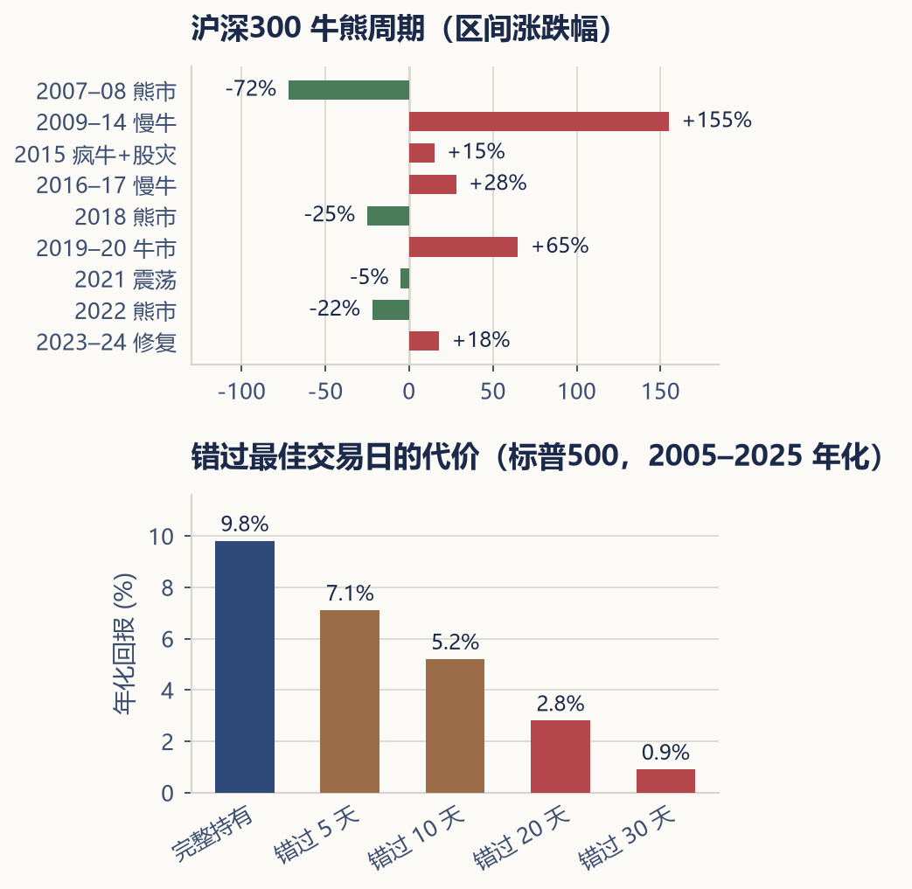

---

**第七部分 · 面对市场周期与人性**

## 第二十九章 · 牛市、熊市与市场周期

> **价格变化时，先检查生活与计划发生了什么变化。**

---

持续上涨容易让人把运气当成能力，持续下跌又容易让人怀疑所有准备。但我们无法在当时准确知道顶部、底部或恢复日期。某些市场和个别资产可能长期不恢复，长期投资不能建立在“一切最终都会回本”的保证上。

```{=latex}
\bookillustration{11-market-thermometer.png}{74mm}{市场情绪可能在恐惧、平衡和贪婪之间变化。温度计用来比喻情绪起伏。}
```

### 上涨时检查自己增加了什么风险

账户涨了之后，容易提高仓位、挪用应急资金或买入原本不需要的热门产品。先看变化后的权重和金额，再回到原目标。盈利不是追加风险的充分理由，别人赚得更多也不说明自己计划失败。

按约定再平衡，可能恢复风险敞口，但不保证保住全部浮盈；持续上涨时也可能少赚。新增投入仍要服从现金流和配置规则，不能同时要求“所有钱都按原比例定投”与“全部新增资金都补低配”，而不写清优先顺序。

### 下跌遇到提款，影响会不同

做一个纯数学例子：初始 10 万元，三个年度收益为 −30%、+20%、+30%。如果不提款，无论顺序如何，末值都为 10.92 万元。若每年末取 1 万元，按上述顺序剩 7.06 万元；倒过来先涨后跌，则剩 8.38 万元。

（来源：递推公式“期末余额 = 上期余额 ×（1 + 当期收益）− 当期提款”；三年、初始 10 万、每年末取 1 万、无通胀与税费；2026-11-05 复核。收益序列是教学设定，不是市场预测。）

这说明相同平均或累计市场回报，未必产生相同生活结果。现金缓冲可以减少被迫卖出的压力，但用完后怎样补充仍要写进计划。不要只告诉需要支付生活费的人“再等市场恢复”。



### 波动时的复核顺序

**先看生活与资金期限。** 必要支出、还款和收入是否变化？近期要用的钱有没有足够的可用储备？如果原来所谓长期资金其实很快就要用，应先纠正期限错配。

**再看产品与持有理由。** 是否出现合同、申赎、费用或底层风险的实质变化？无法判断时先查原始披露和来源，必要时求助合适的专业人士；不能要求新手仅凭感觉分辨“只是情绪”还是永久性损失。

**最后看计划和行为。** 没有触发修改条件、生活与风险能力也未变化时，可以按既定计划执行。若持续失眠或影响工作，说明原来的风险安排可能不适合，需要在平静时重新评估。降低风险并不等于人格失败，继续持有也不自动证明纪律正确。

### 给事后解释留一点警惕

“如果错过最好十天会怎样”这类图，通常事后挑选极值，不能直接代表可实现的择时策略；错过最差日也会改变结果，且极端涨跌可能很接近。没有可复核日收益序列与方法时，不用精确百分比为一种行为背书。

保存当时的计划、信息和修改理由。下一章讨论认知偏差，帮助你在冲动之前多一次暂停和核对。
